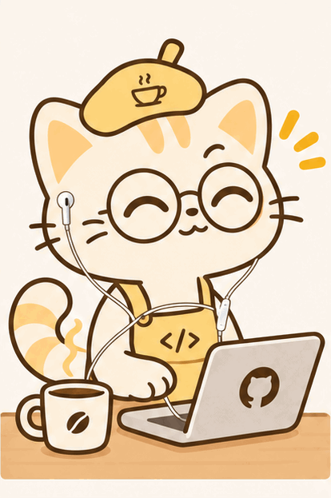

<!--
  Hien's Little Internet Café
  Palette: warm white · butter yellow · coffee brown
-->

#  Cayyo's Little Internet Café ⋆🐾°

*Good coffee. Better ideas. Occasional bugs.*

  
  

<h3>👩🏻‍🍳 whoami</h3>

<table>
<tr>
<td width="65%" valign="middle">
<h3> Hey, I'm Hien! >⩊<</h3>

An Artificial Intelligence student who loves technology and figuring out how things work.

  

<pre><code>$ whoami
name   : Hien
role   : AI Student
focus  : AI · Technology
status : Learning </code></pre>
</td>
<td width="35%" align="center" valign="middle">
</tr>
</table>

### `01 / the tech menu`

**☕ THE TECH MENU**

*Freshly learned · Occasionally debugged*

<table>
<tr>
<td align="center" width="33%">

<h4>☕ Languages</h4>

Python · C++ · Java

</td>
<td align="center" width="33%">

<h4>🛠️ Tools</h4>

Git · GitHub · VS Code

</td>
<td align="center" width="33%">

<h4>🧠 Exploring</h4>

<strong>Artificial Intelligence</strong>

AI concepts &amp; discovery

</td>
</tr>
</table>

🍯 <strong>Also brewing:</strong> Algorithms &amp; problem-solving

---

### `02 / after hours`

ˋˏ✄┈┈┈ THE OFF-DUTY MENU ┈┈┈┈

<table>
<tr>
<td width="20%" align="center">🌏 <strong>Culture</strong></td>
<td width="20%" align="center">🗣️ <strong>Languages</strong></td>
<td width="20%" align="center">✈️ <strong>Travel</strong></td>
<td width="20%" align="center">🎼 <strong>Music</strong></td>
<td width="20%" align="center">🐈 <strong>Cats</strong></td>
</tr>
</table>

---

### `03 / contact`

₊˚⊹ ᰔ HAVE A SEAT & SAY HI ᰔ₊˚⊹ 

---

<strong><em>“If it was easy, everyone would be doing it, and you wouldn’t have an opportunity.”

— Bob Parsons —  </em></strong>

── ⋆⋅☆⋅⋆ ──Thanks for stopping by. See you soon! ᨐฅ ── ⋆⋅☆⋅⋆ ──

